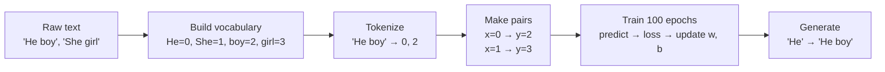

# llm-from-scratch-dummy

The smallest possible "language model", written from scratch in PyTorch to show how an LLM is trained, step by step.

---

## 1. Overview

Large Language Models (LLMs) like GPT look complicated, but they all follow the same basic loop:

1. Turn text into numbers (**tokenization**).
2. Show the model a word and ask it to **predict the next word**.
3. Measure how wrong it was (**loss**) and nudge its parameters to do better (**training**).
4. Use the trained model to **generate** text.

This project strips that loop down to the bare minimum so you can read and understand every line. The "model" has just **2 parameters** and learns two tiny sentences:

```
He  -> boy
She -> girl
```

After training, giving it `He` produces `He boy`, and giving it `She` produces `She girl`.

**Who is this for?** Anyone starting to learn how LLMs work: students, developers new to machine learning, or people preparing for ML interviews. You only need basic Python. No GPU is required.

> This is a learning toy, not a real LLM. It uses a single linear equation instead of a Transformer. It's a first step that shows the training loop before more complex pieces, such as embeddings and attention, are added.

---

## 2. Architecture

```
            ┌──────────────────────────────────────────────────────────┐
  Text  ──► │ Tokenizer        "He boy" ──► [0, 2]                     │
            ├──────────────────────────────────────────────────────────┤
            │ Dataset          input x = [0]   target y = [2]          │
            │ (next-token)     (current word)  (the word that follows) │
            ├──────────────────────────────────────────────────────────┤
            │ Model            y_pred = w · x + b   (2 parameters)     │
            ├──────────────────────────────────────────────────────────┤
            │ Loss + Optimizer MSELoss, AdamW (lr = 0.1)               │
            ├──────────────────────────────────────────────────────────┤
            │ Generator        round(y_pred) ──► token id ──► word     │
            └──────────────────────────────────────────────────────────┘
```

| Component | What it does |
|---|---|
| **Tokenizer** | Splits text on spaces and maps each word to a number (token ID) using a vocabulary built from the data. |
| **Dataset / DataLoader** | Creates (input, target) pairs where the target is the input shifted one word to the right, which is the "predict the next word" task. |
| **Model (`GPTModel`)** | A single linear function `w * x + b`, where `w` (weight) and `b` (bias) are learnable. |
| **Loss function** | Mean Squared Error (MSE): how far the predicted number is from the correct token ID. |
| **Optimizer** | AdamW, which adjusts `w` and `b` to reduce the loss. |
| **Generator** | Feeds a word in, rounds the model's output to the nearest token ID and turns it back into a word. |

---

## 3. Workflow / Data Flow



Step by step, in the same order as the notebook:

1. **Define the data:** two sentences, `"He boy"` and `"She girl"`.
2. **Set the configuration:** context length, batch size and number of epochs.
3. **Build the vocabulary:** collect every unique word and sort it, giving `["He", "She", "boy", "girl"]`.
4. **Create mappings:** `word_to_id` (`"He" → 0`) and `id_to_word` (`0 → "He"`).
5. **Tokenize:** convert each sentence into a list of IDs (`"He boy" → [0, 2]`).
6. **Build the dataset:** split each token list into input `x` (current word) and target `y` (next word).
7. **Create the model:** `y_pred = w * x + b`, with `w` and `b` both starting at 0.
8. **Train:** for each epoch, predict, compute the loss, backpropagate and update the parameters.
9. **Generate:** give the model a starting word and convert its prediction back into the next word.

---

## 4. Tech Stack

| Item | Used for |
|---|---|
| **Python 3.10+** | Programming language |
| **PyTorch** | Tensors, the model (`nn.Module`), the loss, the optimizer and data loading |
| **NumPy** | Numerical support library used by PyTorch |
| **Jupyter Notebook** | Running the code cell by cell and seeing the output |
| **ipykernel** | Lets Jupyter / VS Code use this project's virtual environment |

---

## 5. Project Structure

```
llm-from-scratch-dummy/
├── dummy.ipynb        # The whole project: data → tokenizer → model → training → generation
├── requirements.txt   # Python packages needed to run the notebook
└── README.md          # This file
```

---

## 6. Installation

**Prerequisites:** Python 3.10 or newer, and `git`.

```bash
# 1. Clone the repository
git clone https://github.com/sravanipamu/llm-from-scratch-dummy.git
cd llm-from-scratch-dummy

# 2. Create a virtual environment (keeps packages isolated from your system Python)
python3 -m venv .venv

# 3. Activate it
source .venv/bin/activate        # macOS / Linux
# .venv\Scripts\activate         # Windows (PowerShell or cmd)

# 4. Install the dependencies
pip install -r requirements.txt

# 5. Register the environment as a Jupyter kernel
python -m ipykernel install --user --name llm-from-scratch-dummy --display-name "llm-from-scratch-dummy"
```

---

## 7. Configuration

No environment variables, API keys or config files are needed. All settings are in the configuration cell near the top of `dummy.ipynb`:

| Setting | Default | Meaning |
|---|---|---|
| `data` | `["He boy", "She girl"]` | The training sentences |
| `VOCAB_SIZE` | `4` | Number of unique words (for reference; the vocabulary is built automatically) |
| `CONTEXT_LEN` | `1` | How many words the model sees before predicting the next one |
| `BATCH_SIZE` | `2` | How many examples are processed in one training step |
| `EPOCHS` | `100` | How many full passes over the data during training |
| `lr` (in the optimizer cell) | `0.1` | Learning rate: how big each parameter update is |
| `torch.manual_seed(123)` | `123` | Fixes randomness so results are reproducible |

---

## 8. Execution

**Option A: VS Code**
1. Open the folder in VS Code (with the *Python* and *Jupyter* extensions installed).
2. Open `dummy.ipynb`.
3. Click **Select Kernel** (top right) and choose **llm-from-scratch-dummy**.
4. Click **Run All**.

**Option B: Jupyter in the browser**
```bash
pip install notebook
jupyter notebook dummy.ipynb
```
Then choose **Kernel → Change kernel → llm-from-scratch-dummy** and **Run → Run All Cells**.

---

## 9. Example

**Input (training data):**
```python
data = ["He boy", "She girl"]
```

**Training output (loss goes down as the model learns):**
```
-------------------------------
Epoch: 1
batch: 1 loss: 6.500000
-------------------------------
Epoch: 2
batch: 1 loss: 5.725000
...
-------------------------------
Epoch: 100
batch: 1 loss: 0.000562
-------------------------------
Done!
```

**Generation:**
```python
generate("He")    # → Generated text: He boy
generate("She")   # → Generated text: She girl
```

**Why does it work?** The model learns roughly `w ≈ 1.00` and `b ≈ 1.98`:

| Input word | Token ID (`x`) | `w·x + b` | Rounded | Output word |
|---|---|---|---|---|
| He | 0 | 1.98 | 2 | boy |
| She | 1 | 2.98 | 3 | girl |

---

## 10. Key Concepts

| Concept | Simple explanation |
|---|---|
| **Token** | A piece of text the model works with. Here, one token = one word. |
| **Tokenization** | Converting text into a list of token IDs (numbers). |
| **Vocabulary** | The list of all tokens the model knows. Each gets a unique ID. |
| **Next-token prediction** | The core LLM task: given the words so far, predict the next one. The target is the input shifted by one position. |
| **Context length** | How many previous tokens the model can see. Here it's 1; real LLMs see thousands. |
| **Parameters (weights)** | The numbers the model learns. This model has 2 (`w` and `b`); GPT-style models have billions. |
| **Forward pass** | Running the input through the model to get a prediction. |
| **Loss** | A score of how wrong the prediction is. Training tries to make it as small as possible. |
| **Backpropagation** | `loss.backward()` computes how each parameter should change to lower the loss. |
| **Optimizer** | `optimizer.step()` applies those changes. AdamW is a popular choice for LLMs. |
| **Epoch** | One full pass through the training data. |
| **Batch** | A group of examples processed together in one step. |
| **Inference / Generation** | Using the trained model to produce new output (`model.eval()` + `torch.no_grad()`). |

**How real LLMs differ:** real models predict a *probability for every word* in the vocabulary (using cross-entropy loss), use *embeddings* to represent words as vectors, and use *Transformer attention* to look at many previous words. This project replaces all of that with one straight line, so the training loop itself is easy to see.

---

## 11. Troubleshooting

| Problem | Solution |
|---|---|
| `ModuleNotFoundError: No module named 'torch'` | The notebook is using the wrong Python. Select the **llm-from-scratch-dummy** kernel, or activate `.venv` and run `pip install -r requirements.txt`. |
| Kernel **llm-from-scratch-dummy** doesn't appear | Run step 5 of [Installation](#6-installation) again, then reload VS Code or restart Jupyter. |
| `UserWarning: Failed to initialize NumPy` | Install NumPy in the active environment: `pip install numpy`. |
| `pip install torch` fails | Check your Python version with `python --version`. Use a version supported by PyTorch (see [pytorch.org](https://pytorch.org/get-started/locally/)). |
| `NameError` (for example `model is not defined`) | Cells were run out of order. Use **Restart Kernel → Run All**. |
| Generated word is wrong, or `KeyError` in `generate` | The model may be under-trained (increase `EPOCHS`), or you passed a word that isn't in the vocabulary. Only `He` and `She` are valid starting words. |
| `python3: command not found` (Windows) | Use `python` or `py` instead of `python3`. |

---

## License

Free to use for learning. Add a `LICENSE` file (for example MIT) before publishing if you want to make the terms explicit.
